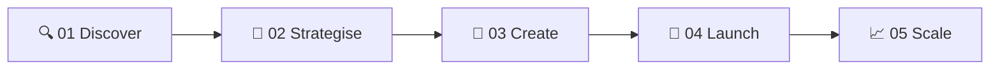

### ⚡ AI-first creative studio for brands that want to grow faster, look better, and convert harder.

  
  
  
  
  

**Great marketing shouldn't take 6 months. Ours doesn't.**
 
*From strategy to execution (content, web, ads, and automation) live in weeks, not quarters.*

---

## 📊 Tagverse at a Glance

| 🚀 **3x** | 🌍 **8** | ⏱️ **< 14 days** | ♾️ **∞** |
|:---:|:---:|:---:|:---:|
| Average ROAS improvement | Markets served | Onboarding to live campaigns | Custom campaigns |

---

## 👋 About Us

**Tagverse** is an AI-first creative studio helping brands grow with strategy, content, web, ads, and automation. We don't just make content. **We build marketing systems that compound**, where every asset, every campaign, and every automation works together.

We work with founders, CMOs, and growth teams who want a creative partner that **executes, not just advises**. A [Strucureo](https://www.t4gverse.com) brand.

<table>
<tr>
<td width="33%" align="center">

### 🤖 AI-First Agency
Every deliverable is built with AI tools that cut time and increase output quality.

</td>
<td width="33%" align="center">

### 🌏 Multi-Market
Active across India, UAE, Malaysia, Singapore, and beyond.

</td>
<td width="33%" align="center">

### 📈 Performance-Led
We tie our work to metrics that matter: leads, ROAS, and revenue.

</td>
</tr>
</table>

---

## 🧩 What We Do

| | Service | What's inside |
|:---:|---|---|
| 📱 | **Social Media Management** | Content calendars • Reel production • Caption writing • Community management • Analytics |
| 🤖 | **AI & Automation** | n8n workflows • WhatsApp automation • CRM integration • AI content systems • Lead qualification |
| 💻 | **SaaS & Website** | Web design • Next.js builds • SaaS development • Landing pages • E-commerce |
| 🌀 | **WebGL & Interactive** | 3D web • Scroll animations • GSAP • Three.js • Interactive storytelling |
| 🎨 | **Brand Strategy & Identity** | Brand audits • Naming • Logo & identity • Design systems • Messaging & positioning |
| 🎯 | **Paid Media** | Meta Ads • Google Ads • Lead gen • Retargeting • Campaign strategy |
| 🎙️ | **Podcast Studio** | Production • Editing & mix • Live recordings • Distribution • Studio booking (Chennai) |
| 🎬 | **Video Marketing** | Brand films • Reels • Commercials • Motion graphics • Post-production |

---

## ⚙️ The TAGVERSE System

| Step | What happens |
|:---:|---|
| **01 Discover** | We audit your brand, market, and competitors to find the gaps worth owning. |
| **02 Strategise** | We build a 90-day growth plan across content, paid, and digital channels. |
| **03 Create** | Our studio produces content, ads, and digital assets built for performance. |
| **04 Launch** | Campaigns go live with full tracking, pixel setup, and automation in place. |
| **05 Scale** | We optimise weekly and unlock new channels as data comes in. |

### 🧠 Growth OS
Every client gets a custom **Growth OS**: a connected system of content, ads, automation, and analytics that runs your marketing like a machine.

- ✍️ **Smart content engine**: reels, carousels, and copy built around your ICP and buying triggers
- 💸 **Paid media that converts**: Meta and Google campaigns managed with AI-assisted optimisation
- 🔗 **Automation layer**: WhatsApp flows, lead nurture, CRM sync, with zero manual follow-up

---

## 🏆 Results

> ### 312% ROAS improvement
> **How a D2C skincare brand scaled from ₹8L to ₹32L monthly revenue in 4 months.**
>
> *"Tagverse completely transformed our digital presence. Their AI-driven content strategy and paid media execution delivered a 3x return on ad spend within the first quarter. The team feels like an extension of our own."*
> **Priya Mehta**, Founder, GlowRoot Naturals

👉 [Read the full case study](https://www.t4gverse.com/portfolio)

### 🤝 Trusted by brands we've helped grow
`Waves` • `Dust2Glow` • `Simple Krew` • `Soora Express` • `KTH` • `Elephant Production` • `Adroit Design` • `Abroadly`

---

## 🛠️ Our Stack

---

## 📦 Repositories

> 📌 Pin your best repos on the organization page and list them here.

| Repository | Description |
|---|---|
| [**website**](https://github.com/YOUR-ORG/website) | Official Tagverse website |
| [**automation-workflows**](https://github.com/YOUR-ORG/automation-workflows) | n8n & WhatsApp automation templates |
| [**ui-components**](https://github.com/YOUR-ORG/ui-components) | Reusable UI & WebGL components |

*(Replace `YOUR-ORG` and the repo names with your real ones.)*

---

## 🎙️ Tagverse Studio

A **live podcast studio you can actually be part of**, based in Chennai. Record, edit, distribute, or attend live recordings.
👉 [Book the studio](https://www.t4gverse.com/studio)

---

## 🤝 Contributing

1. 🍴 **Fork** the repository
2. 🌿 **Create** a branch: `git checkout -b feature/your-feature`
3. 💾 **Commit**: `git commit -m "feat: add your feature"`
4. 📤 **Push**: `git push origin feature/your-feature`
5. 🔃 **Open** a Pull Request

---

## 🚀 Ready to see what TAGVERSE can do for your brand?

*Spots are limited each month.*

&nbsp;

&nbsp;

© 2026 Tagverse AI, Inc. • A Strucureo brand

